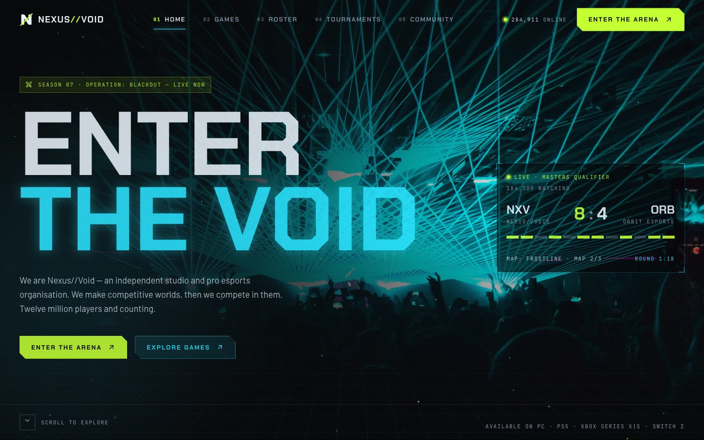
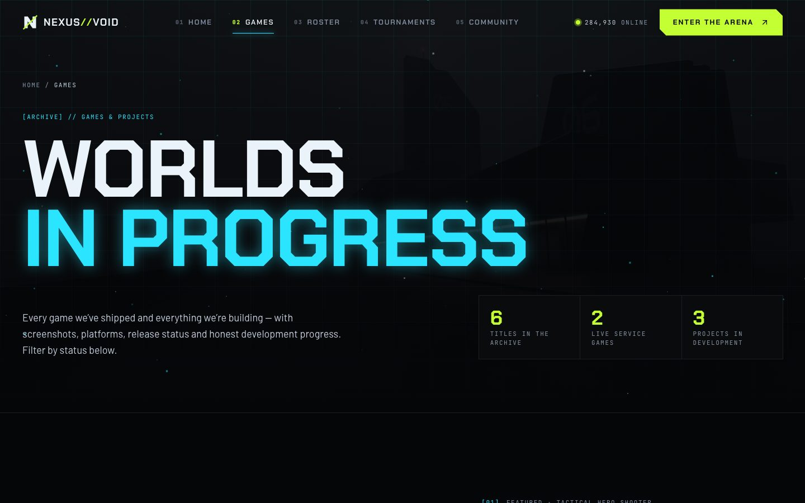
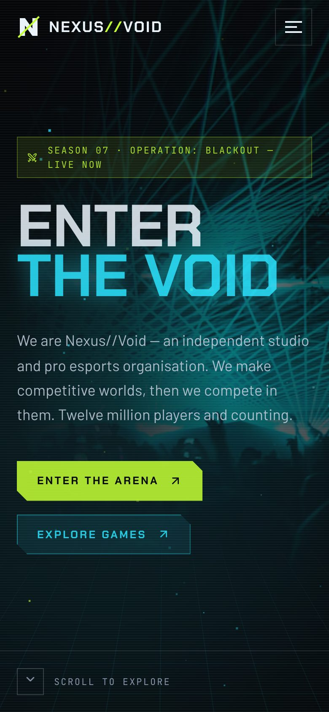
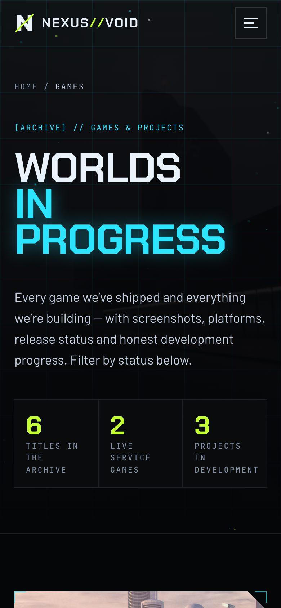

# Nexus//Void

> *We build worlds worth fighting for.*

A two-page website for **Nexus//Void**, a fictional independent game studio and pro esports organisation based in Berlin. The design is a dark, HUD-inspired interface — near-black canvases, electric cyan and acid lime signals, chamfered panels and monospaced telemetry — that stays disciplined rather than chaotic.

**Live site:** <https://gaming-studio-two.vercel.app>



## Features

- **Cinematic hero**: an animated perspective grid floor, a lightweight canvas particle field, mouse-reactive parallax on the key art and a "decode" headline that scrambles glyphs before locking in. A live-match HUD panel ticks its round timer and viewer count.
- **HUD design language**: chamfered clip-path panels, corner brackets, scanlines and a consistent duotone (desaturated, cyan-tinted) photo treatment that blooms back to full colour on hover.
- **Home page**
  - A news ticker and a featured game card with a 3D pointer tilt and glare.
  - An in-development project with an animated progress meter and devlog.
  - The pro roster, with stats revealed on hover or focus.
  - Count-up studio statistics.
  - A tournament schedule with an accessible registration dialog.
  - Community cards, a sponsor wall and a "Transmission" newsletter with channel toggles.
- **Games page**
  - Two featured showcases, each with a swappable screenshot viewer.
  - A status-filterable portfolio animated with Framer Motion layout transitions, including a redacted "Classified" project.
  - A screenshot wall with a keyboard-navigable lightbox.
  - An open development roadmap with stage markers, the studio leadership team and a playtest CTA.
- **Forms**: tournament registration, playtest applications and the newsletter all validate inline and show loading and success states. They're demos, so nothing is sent.
- **Accessibility**: a skip link and semantic landmarks. The slide-in mobile panel traps focus and closes on Esc. Scrambled text keeps a screen-reader copy, and filter and channel toggles expose `aria-pressed`. Progress bars carry ARIA values and focus rings are visible.
- **Reduced motion**: Framer Motion honours the OS setting, the particle field renders a single static frame, and CSS keyframe animations are neutralised.
- **SEO**: per-page metadata and Open Graph, canonical URLs, sitemap, robots and an SVG favicon.

## Pages

| Route    | Contents |
| -------- | -------- |
| `/`      | Hero + live match, news ticker, featured game (VOIDFALL), latest project (ECHO PROTOCOL), pro roster, stats, upcoming tournaments, community, sponsors, newsletter |
| `/games` | Archive hero, featured showcases (VOIDFALL, NEON DRIFT: ZERO), filterable portfolio, screenshot wall + lightbox, development roadmap, studio team, community / playtest CTA |

## Design system

| Token       | Value     | Use |
| ----------- | --------- | --- |
| Void        | `#050608` | Base background |
| Void 2 / 3  | `#0A0D12` / `#10151D` | Panels and raised surfaces |
| Snow        | `#EAF2FA` | Primary text |
| Fog / Steel | `#C6D0DE` / `#8793A6` | Secondary and tertiary text |
| Electric Cyan | `#2BE4FF` | Signal colour: links, glow, data |
| Acid Lime   | `#C3FF33` | Primary actions, live states |

**Type:** Chakra Petch (display), Barlow (body), JetBrains Mono (HUD labels).

## Tech stack

- Next.js 16 (App Router, Turbopack, static output)
- React 19 + TypeScript
- Tailwind CSS v4
- Framer Motion
- Lucide icons
- Unsplash CDN images through a custom `next/image` loader

## Getting started

Requires Node.js 20.9+.

```bash
npm install
npm run dev      # http://localhost:3000
```

### Build

```bash
npm run build
npm start
```

### Lint

```bash
npm run lint
```

## Deployment

```bash
npx vercel --prod
```

Optionally set `NEXT_PUBLIC_SITE_URL` for canonical and Open Graph URLs on a custom domain.

## Project structure

```
app/                 routes, layout, template (page transitions), SEO files
components/
  home/              hero, particle field, live match, roster, tournaments, …
  games/             showcase, portfolio filters, lightbox, roadmap, team
  layout/            navbar + mobile panel, footer, legal dialog
  motion/            Reveal, Stagger, Scramble, Counter, Parallax
  ui/                HudButton, Brackets, SectionLabel, Img
lib/                 site config, games / roster / tournament data, hooks
```

## Screenshots

| Home | Games |
| ---- | ----- |
|  |  |
|  |  |

## Notes

- Nexus//Void, its games, players, sponsors and events are fictional. Sponsor marks are typographic placeholders, not real brands.
- Forms are front-end demos — **no data is sent or stored**.
- Photography from [Unsplash](https://unsplash.com), used under the [Unsplash License](https://unsplash.com/license).

## License

Code released under the [MIT License](LICENSE).
